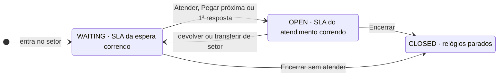

# ADR-0019 — Filas de atendimento: fila compartilhada por setor, atendente Online/Offline e SLAs de espera e de atendimento

- **Status:** Aprovada (2026-10-19, PR #104) — implementação pelos itens B-65 a B-68 e B-112 a B-114
- **Data de criação:** 2026-10-19
- **Última revisão:** 2026-10-20
- **Autor:** Engenharia (Claude Code), a partir das regras ditadas pelo responsável do projeto
- **Revisores:** responsável do projeto (PR #104)
- **Versão:** 1.0
- **Decisores:** responsável do projeto
- **Contexto técnico:** `apps/api/src/modules/conversation`, `apps/api/src/modules/sla`,
  `apps/api/src/modules/user`, `apps/api/src/modules/queue`, `apps/api/src/modules/events`,
  `apps/api/prisma/schema.prisma`, `src/components/ConversationQueue.jsx`,
  `src/hooks/useConversations.js`, `src/components/settings/SettingsPanel.jsx`

> Ciclo de vida conforme `README.md` desta pasta. Esta ADR abre a trilha de evolução das filas
> de atendimento (B-65 a B-68 e B-112 a B-114). As regras de produto são do responsável do
> projeto (2026-10-19); o resto é a proposta técnica, revisada e aprovada por ele no PR #104.

## Contexto

Como funciona hoje:

- **Entrada na fila.** Toda conversa nova nasce `WAITING` ("na fila, sem atendente"). Ela ganha
  departamento — o **setor**, cada um com a sua fila (decisão de 2026-10-17) — pela conexão do
  WhatsApp (B1-2), pelo menu do auto-atendimento (B-35: o paciente responde com o número da
  opção, como "1 - Agendamento de consultas especializadas") ou por atribuição manual.
- **Quem atende cada setor.** O vínculo atendente × setor já existe, e um atendente pode estar em
  vários setores. Mas ele só se edita pelo lado do setor (Configurações → Grupos → Membros): o
  cadastro do usuário não mostra nem permite escolher os setores.
- **Quem vê.** Vale o escopo do B-40: o atendente (`AGENT`) vê as conversas dos seus setores, as
  atribuídas a ele e as sem setor; `ADMIN` e `SUPERVISOR` veem a empresa toda. O tempo real segue
  a mesma regra (salas por setor, `events/scope-rooms.ts`).
- **Atender.** O botão "Atender" da aba Fila (B-31, pedido do responsável em 2026-07-25: botão
  manual, não atribuição automática) chama `PATCH /conversations/:id/assign` com o id de quem
  clicou, e a conversa vai para `OPEN`. Responder uma conversa em espera também a assume
  (`send-message.service.ts`) — só `ADMIN` e `SUPERVISOR` podem, porque o `AGENT` só responde
  conversa atribuída a ele.
- **SLA.** Só a espera tem prazo: o `maxWaitSecs` da fila do setor (padrão 300 s). Ao entrar na
  fila, a API agenda um job atrasado (`sla-check:<id da conversa>`). Se a conversa ainda estiver
  `WAITING` quando ele rodar, a API grava `slaBreachedAt`, emite `sla.breached` e avisa
  supervisores e admins. Sair da fila cancela o job e zera a marca (B-98). Conversa aberta pela
  empresa ou que chega fora do expediente não tem SLA (B-98).

O que falta ou está errado:

1. **O atendente não tem estado.** O sistema não sabe quem está trabalhando (`users.lastSeenAt`
   existe, mas nunca é gravado).
2. **"Atender" não é atômico.** O `assign` grava o atendente sem conferir se a conversa ainda
   está na fila. Dois atendentes que clicam juntos recebem os dois 200 e o último sobrescreve o
   primeiro. Pelo mesmo caminho, um atendente toma a conversa que um colega do setor já atende.
3. **A estratégia da fila é uma promessa vazia** (M-21): a tela Configurações → Filas oferece
   "Round-robin" (o padrão), "Manual" e "Menos ocupado primeiro", mas `ROUND_ROBIN` e
   `LEAST_BUSY` nunca são aplicados.
4. **Não se sabe desde quando a conversa espera.** O "tempo na fila" do front (B-104) parte do
   `createdAt`, errado para conversa transferida ou reaberta, e não há como entregar "a mais
   antiga" (B-67).
5. **Desatribuir deixa a conversa órfã.** `assign` com `agentId: null` numa conversa `OPEN`
   mantém `OPEN` sem atendente: ela some da fila e fica sem SLA.
6. **O SLA some à noite.** A conversa que chega fora do expediente nunca ganha prazo, nem quando
   o expediente abre.
7. **O atendimento não tem prazo.** Uma conversa atendida e esquecida não alerta ninguém.
8. **Os setores do atendente não aparecem no cadastro dele** (ver "Quem atende cada setor").

## Problema

A conversa chega a quem vai atender por uma fila compartilhada do setor ou por distribuição
automática para um atendente? O que significa o atendente estar Online ou Offline? De quem é o
relógio do SLA da espera — do setor ou do atendente? E o atendimento em si deve ter um SLA?

## Alternativas consideradas — Pergunta 1 (como a conversa chega ao atendente)

### Alternativa A — Fila compartilhada do setor ("quem atender primeiro")
- **Prós:** é o modelo que o responsável descreveu, o mais comum nas centrais de multiatendimento,
  e o que o botão "Atender" do B-31 já pressupõe. Nenhuma conversa fica presa com um atendente que
  saiu sem avisar, porque ela segue visível para o setor inteiro. Não exige rodízio nem contagem
  de carga.
- **Contras:** depende de alguém olhar a fila. Dois atendentes podem disputar a mesma conversa
  (resolvido pela troca atômica das regras abaixo). Sem distribuição, o atendente pode escolher
  só as conversas "fáceis" (mitigado pelo "Pegar próxima", que entrega a mais antiga).
- **Complexidade:** baixa.
- **Risco:** baixo.
- **Impacto:** `assign`, rota nova de atender, "Pegar próxima", painel.
- **Custo estimado:** baixo.

### Alternativa B — Distribuição automática exclusiva (`ROUND_ROBIN`/`LEAST_BUSY`)
- **Prós:** ninguém precisa escolher; a carga fica equilibrada.
- **Contras:** a conversa vira de um atendente antes de alguém falar com o paciente — o SLA
  passa a ser do atendente, o contrário da regra do responsável. Atendente que esquece de ficar
  Offline segura conversas. Exige redistribuir quando alguém fica Offline, encerra ou entra.
- **Complexidade:** alta.
- **Risco:** médio (concorrência e redistribuição).
- **Impacto:** todo o ciclo da conversa.
- **Custo estimado:** alto.

### Alternativa C — Distribuição sugerida (indica um atendente; qualquer um pode atender antes)
- **Prós:** mantém "quem atender primeiro" e ainda aponta um responsável.
- **Contras:** dois "donos" para explicar (o sugerido e o que atendeu), mais estado para manter
  e o mesmo rodízio da Alternativa B.
- **Complexidade:** média-alta.
- **Risco:** médio.
- **Impacto:** o mesmo da Alternativa B.
- **Custo estimado:** médio.

### Alternativa D — Não fazer nada
- **Custo de manter como está:** seguem os problemas 1 a 5 do contexto — disputa sem vencedor
  definido, estratégia de fila que não faz nada e tempo de espera errado.

## Decisão Tomada — Pergunta 1

**Alternativa A**, escolhida pelo responsável em 2026-10-19 ("vamos usar o que é mais usado pelos
sistemas de multiatendimento"). A distribuição automática sai do plano por enquanto; se voltar,
vem numa ADR nova que supera esta parte.

## Alternativas consideradas — Pergunta 2 (estado do atendente)

### Alternativa A — Online e Offline, trocados só pelo próprio atendente
- **Prós:** simples; o atendente sabe o próprio estado; nada muda sozinho por queda de rede.
- **Contras:** quem fecha o navegador sem ficar Offline continua aparecendo Online. Mitigado:
  o logout põe Offline e, na fila compartilhada, ninguém fica com conversa nova presa por isso.
- **Complexidade:** baixa.

### Alternativa B — Online, Pausa e Offline (plano de 2026-10-17)
- **Prós:** o painel do supervisor distingue intervalo de saída.
- **Contras:** um estado a mais sem efeito diferente na fila compartilhada — nos dois casos o
  atendente não pega conversa nova.
- **Complexidade:** baixa-média.

### Alternativa C — Presença automática pela conexão (WebSocket aberto = Online)
- **Prós:** não depende de o atendente lembrar.
- **Contras:** aba aberta não é atendente trabalhando, e queda de rede faria o estado piscar.
  Contraria a regra do responsável: o atendente muda o estado "por conta própria".
- **Complexidade:** média (contagem de sockets entre réplicas, B-80).

## Decisão Tomada — Pergunta 2

**Alternativa A**, escolhida pelo responsável em 2026-10-19: só Online e Offline (a Pausa pode
voltar se fizer falta). Na mesma data, o responsável decidiu que, ao ficar Offline, as conversas
que o atendente já atende **continuam com ele**, e que atendente Offline **não pega conversa da
fila**.

## Alternativas consideradas — Pergunta 3 (de quem é o relógio do SLA da espera)

### Alternativa A — Do setor: começa quando a conversa entra na fila e para quando alguém atende
- **Prós:** é a regra do responsável. Mede o que o paciente sente — quanto esperou até alguém
  pegar a conversa —, independentemente de quem estava Online.
- **Contras:** setor sem ninguém Online estoura o SLA. É o comportamento desejado: o alerta
  existe para isso.

### Alternativa B — Do atendente (relógio por pessoa, reiniciado a cada atribuição)
- **Contras:** só faz sentido com distribuição (Pergunta 1, Alternativa B) e esconde a espera
  real do paciente a cada redistribuição.

## Decisão Tomada — Pergunta 3

**Alternativa A**, regra do responsável em 2026-10-19: "a SLA é cronometrada pelo departamento e
não pelo atendente; quem atender primeiro zera a SLA".

## Alternativas consideradas — Pergunta 4 (SLA do atendimento)

### Alternativa A — Do "Atender" ao "Encerrar", com prazo por setor
- **Prós:** é o tempo de atendimento (TMA) que as centrais acompanham, ao lado do tempo de espera.
  Pega a conversa atendida e esquecida. Reaproveita o mecanismo do SLA da espera: prazo gravado
  na conversa, job atrasado e relógio no expediente.
- **Contras:** conta também o tempo em que o paciente demora a responder — a conversa pode
  estourar por demora do paciente.
- **Complexidade:** média.

### Alternativa B — Até a 1ª resposta do atendente (tempo de primeira resposta)
- **Prós:** mede só o que depende do atendente.
- **Contras:** depois da primeira mensagem, o paciente pode ficar sem retorno e nada alerta.
- **Complexidade:** baixa-média.

### Alternativa C — Não fazer nada (só o SLA da espera)
- **Custo de manter como está:** atendimento parado não alerta ninguém (problema 7).

## Decisão Tomada — Pergunta 4

**Alternativa A**, escolhida pelo responsável em 2026-10-19 ("assim que alguém atribuir a
conversa para ele, a SLA da espera é finalizada, e é iniciada a SLA do atendimento"), com as
definições dele: prazo **por setor**; ao estourar, **avisa quem está atendendo e os supervisores
e admins**; transferência para outra pessoa do mesmo setor **continua** o relógio, e mudança de
setor **recomeça** com o prazo do setor novo.

## Regras

O que muda na prática. Vêm do responsável as regras 1 a 3, 8 a 10, 13 e 18 a 23 e, na regra 4,
quem pode transferir; as demais são a proposta técnica que as implementa, aprovada por ele.

### Fila do setor

1. A conversa entra na fila do setor quando ganha setor (conexão, menu do auto-atendimento ou
   transferência) e fica `WAITING`, sem atendente, visível para quem enxerga o setor (B-40).
   Ninguém a recebe automaticamente.
2. Ela sai da fila quando alguém **atende**: botão **Atender**, **Pegar próxima** (B-67) ou a
   primeira resposta de `ADMIN`/`SUPERVISOR` numa conversa em espera.
3. **Quem atender primeiro fica com a conversa.** A passagem `WAITING → OPEN` é uma atualização
   condicional no banco: só vale se a conversa ainda estiver na fila e sem atendente. Se dois
   atenderem ao mesmo tempo, vence quem o banco processar primeiro — para os atendentes, é como
   um sorteio. O outro recebe `409` com a mensagem "Fulano já está atendendo", e a conversa sai
   da fila de todos pelo evento em tempo real. É a linha do ADR-0004: a garantia fica no banco e
   é validada com concorrência real.
4. **Atender e transferir são ações diferentes.** Atender ganha rota própria
   (`POST /conversations/:id/attend`: só conversa na fila, sempre para quem chama). O
   `PATCH /conversations/:id/assign` fica só para **transferir**, para uma pessoa que esteja Online
   ou para um setor. Quem pode o quê (regra do responsável, 2026-10-19):
   - o **atendente** transfere as conversas que estão com ele, para outro atendente ou para outro
     setor. Não transfere a conversa de um colega nem puxa para si uma conversa que já está com
     outra pessoa (`403`);
   - **supervisor e admin** transferem qualquer conversa e **puxam para si** a de outro atendente
     (precisam estar Online, como em todo atender).

   Desatribuir, ou mandar para um setor sem indicar pessoa, **devolve a conversa para a fila**
   (`WAITING`) com SLA novo — acaba a conversa `OPEN` sem atendente. A troca confere no banco quem
   estava com a conversa naquele instante: se mudou no meio (o atendente transferiu enquanto o
   supervisor puxava), quem chegou depois recebe `409`.
5. **Pegar próxima** entrega a conversa em espera mais antiga (pelo início da espera) dos setores
   de quem pede, numa instrução só no Postgres (`FOR UPDATE SKIP LOCKED`): dois pedidos ao mesmo
   tempo recebem conversas diferentes. Conversa sem setor fica de fora do "Pegar próxima", mas
   continua visível e pode ser atendida pelo botão.
6. A fila tem um comportamento só: compartilhada (`MANUAL`). A API deixa de aceitar
   `ROUND_ROBIN` e `LEAST_BUSY`, as filas existentes passam para `MANUAL`, que vira o padrão, e a
   tela Configurações → Filas deixa de oferecer a escolha. O campo para de prometer o que não
   existe (M-21). Continua sem limite de conversas por atendente (decisão de 2026-10-18).
7. O seed de demonstração cria os 13 setores, cada um com a sua fila (decisão de 2026-10-17), e o
   menu do auto-atendimento com uma opção por setor.

### Estado do atendente

8. Dois estados: **Online** e **Offline**. Todo usuário tem um, inclusive `ADMIN` e `SUPERVISOR`,
   que também atendem. Usuário novo começa Offline.
9. Só o próprio usuário troca o seu estado, pelo seletor do painel. O login não muda o estado. O
   **logout põe Offline** (é o atendente saindo do sistema), e desativar o usuário também. Fechar
   a aba ou cair a conexão não muda nada.
10. **Online:** recebe o aviso de conversa nova nos seus setores e pode atender e pegar a
    próxima. **Offline:** não recebe esse aviso e não pega conversa da fila — a API recusa com
    `409` ("Fique Online para atender"). Continua vendo as listas e respondendo as conversas que
    já são suas, que **continuam com ele**.
11. `ADMIN` e `SUPERVISOR` veem o estado de todos em tempo real: evento `user.availability` na sala
    `company:<id>:all` e na `agent:<id>`, que sincroniza as outras abas do próprio usuário.
12. O estado fica no banco (`users.availability`, `ONLINE`/`OFFLINE`, e
    `users.availabilityChangedAt`), não no Redis: é uma escolha do usuário, precisa sobreviver a
    reinício e entra em consultas. Cada troca vai para a auditoria (`user.availability_changed`).

### SLA da espera

13. O SLA da espera é do setor. O prazo é o `maxWaitSecs` da fila do setor; o relógio começa
    quando a conversa entra na fila e só para quando alguém atende. Setor sem ninguém Online não
    pausa o relógio: a conversa estoura, e o alerta segue para supervisores e admins, como hoje.
14. Voltar para uma fila abre um **ciclo novo**: transferência de setor (vale o prazo da fila de
    destino), devolução à fila ou reabertura.
15. A conversa ganha dois campos: `waitingSince` (início da espera atual — o "tempo na fila" do
    painel e a ordem do "Pegar próxima") e `waitSlaDueAt` (prazo da espera atual, calculado pela
    API; o painel mostra quanto falta, ou há quanto estourou, sem refazer a conta). O job do SLA
    passa a ser agendado para esse prazo. O `slaBreachedAt` continua sendo o estouro da espera.
16. Ao ser atendida, a marca de violação é zerada, como no B-98, e o ciclo vai para a auditoria
    (`conversation.attended`: quem atendeu, quanto esperou, o prazo e se estourou).
17. O relógio **só anda no expediente** do auto-atendimento, no fuso da empresa — vale para os dois
    SLAs. A conversa que chega fora do expediente começa a contar na abertura; a espera em curso
    no fechamento continua na abertura seguinte. Sem horário configurado, o relógio anda o dia
    todo, como hoje. Conversa aberta pela empresa continua sem SLA da espera (B-98).

### SLA do atendimento

18. O SLA do atendimento começa quando a conversa sai da fila com alguém — Atender, Pegar
    próxima, 1ª resposta ou transferência direta para uma pessoa, no mesmo instante em que o SLA
    da espera termina — e termina ao **encerrar** a conversa. É o tempo de atendimento (TMA).
19. O prazo é **por setor**: campo "Tempo máx. de atendimento" na fila de cada setor, ao lado do
    "Tempo máx. de espera" (`queues.maxServiceSecs`; vazio = setor sem SLA do atendimento). O
    relógio só anda no expediente, como o da espera (regra 17).
20. Transferência para outra pessoa do **mesmo setor**: o relógio continua (o SLA é do setor, não
    do atendente). **Mudou de setor:** recomeça com o prazo do setor novo — e, se a conversa
    voltar para a fila do setor novo, antes corre o SLA da espera de lá. Devolver a conversa para
    a fila fecha o ciclo do atendimento; o próximo atender abre outro.
21. Ao estourar, a conversa fica marcada (`serviceSlaBreachedAt`) e destacada no painel, e a API
    **avisa quem está atendendo e os supervisores e admins** (notificação e evento em tempo real).
    Campos novos: `attendedAt` (início do atendimento atual) e `serviceSlaDueAt` (prazo), com job
    próprio no Bull, como o da espera. Ao encerrar, a auditoria registra quanto durou o
    atendimento e se estourou.

### Setores do atendente e menu do paciente

22. No cadastro e na edição do usuário, um campo lista os **setores que ele atende** — um ou
    vários (`departmentIds` em `POST /users` e `PATCH /users/:id`, conferidos contra a empresa).
    É o mesmo vínculo da tela Grupos → Membros, que continua existindo.
23. O paciente escolhe o setor no menu do auto-atendimento (B-35) — por exemplo, "1 - Agendamento
    de consultas especializadas" e "2 - Resultado de exames". Ao escolher, a conversa entra na
    fila do setor, os atendentes Online do setor são avisados e o SLA da espera começa (regras 1,
    10 e 13).

## Plano de implementação

Na ordem da tabela:

| Item | Entrega | Regras |
|---|---|---|
| B-65 | Estado Online/Offline: campos, `PATCH /users/me/availability`, logout e desativação põem Offline, evento, auditoria, estado no `GET /users` e **seletor no painel** (sem ele, ninguém conseguiria atender depois do B-66) | 8–12 |
| B-113 | Setores no cadastro e na edição do atendente (um ou vários), na API e na tela de Usuários | 22 |
| B-66 (M-21) | Atender atômico (rota própria, `409`, Online obrigatório) e a 1ª resposta pelo mesmo caminho; transferência com as permissões da regra 4 (o atendente só as dele; supervisor e admin puxam) e que devolve à fila; `waitingSince`, `waitSlaDueAt` e auditoria do ciclo; estratégia `MANUAL` com migração das filas e sem a escolha na tela de Filas; seed com os 13 setores e o menu com uma opção por setor | 1–4, 6, 7, 13–16, 23 |
| B-67 | Pegar próxima | 5 |
| B-112 | Relógio dos SLAs só no expediente (função pura ao lado de `isWithinBusinessHours`) | 17 |
| B-114 | SLA do atendimento: prazo por setor na tela de Filas, relógio do Atender ao Encerrar, alerta para quem atende e para supervisor e admin, regra de transferência | 18–21 |
| B-68 (L-09) | Painel: fila com tempo e SLA da espera, conversas em atendimento com o SLA do atendimento, "Pegar próxima", aviso de conversa nova só para quem está Online, recusa `409` explicada, visão do supervisor (setores × atendentes) com destaque para conversa de atendente Offline aguardando resposta. Layout pelos prints do responsável | todas (front) |

## Justificativa Técnica

- A fila compartilhada aplica as regras do responsável sem infraestrutura nova. "Quem atender
  primeiro" é uma atualização condicional (`updateMany` com `status: WAITING` e `agentId: null`,
  conferindo se mudou uma linha), e o "Pegar próxima" é uma instrução só com
  `FOR UPDATE SKIP LOCKED`. Os dois seguem o ADR-0004: garantia no banco e teste com carga real.
- A rota própria de atender separa duas intenções que o `assign` misturava: pegar para si (pode
  perder a disputa, exige Online) e transferir (ação sobre outra pessoa ou setor). A mistura é o
  que deixava a disputa invisível.
- O estado fica no Postgres, e não no Redis (ADR-0014), porque não é presença efêmera: é uma
  escolha do usuário, que o painel e o "Pegar próxima" consultam junto com conversas e setores.
- Dois SLAs — espera e atendimento — é o padrão das centrais (tempo de espera e tempo de
  atendimento). O do atendimento reaproveita o mecanismo do da espera: prazo gravado na conversa,
  job atrasado no Bull e a mesma função de expediente (B-112).
- Os prazos são gravados (`waitSlaDueAt`, `serviceSlaDueAt`) porque, com o relógio no expediente
  (regra 17), o prazo deixa de ser "início + segundos". Calcular uma vez na API evita reimplementar
  o horário comercial no front e mantém o painel e o alerta de acordo. O `slaBreachedAt` mantém o
  nome para não quebrar o contrato da API; os campos novos já nascem com o nome do SLA a que
  pertencem.
- Nenhum status novo na máquina de estados da conversa: "atendida" continua sendo `OPEN`. O índice
  parcial de uma conversa ativa por contato (B-49, AER-019) não muda.
- Entre as Alternativas A e C da Pergunta 1 não houve empate técnico a desfazer: a escolha foi de
  produto, do responsável.

## Trade-offs

- **O que foi ganho:** regras simples de explicar ao atendente; nenhuma conversa nova presa com
  quem saiu; vencedor definido na disputa; SLAs que medem a espera real do paciente e o
  atendimento parado.
- **O que foi perdido:** o equilíbrio automático de carga e a Pausa no painel; o atendente
  escolhe o que atende (o "Pegar próxima" mitiga); o SLA do atendimento não pausa enquanto o
  paciente demora a responder.
- **O que permanece como dívida técnica:** o estado manual pode mostrar Online quem fechou o
  navegador sem sair (ver Critérios de Revisão). O histórico dos SLAs fica na auditoria, sujeita à
  purga do B-101.

## Consequências

### Positivas
- "Atender" com vencedor definido e mensagem clara para quem perdeu.
- Atendente não toma conversa de colega; supervisor e admin conseguem intervir puxando a conversa
  para si.
- Atendimento parado (atendido e esquecido) passa a alertar quem atende e o supervisor.
- Tempo na fila correto também para conversa transferida e reaberta.
- M-21 resolvido: a estratégia gravada é a que funciona.
- A conversa que chega à noite passa a ter SLA a partir da abertura.
- Quem cadastra o atendente já escolhe os setores dele.

### Negativas
- Atendente Offline com conversa em andamento: o paciente espera até ele voltar ou o supervisor
  transferir — e o SLA do atendimento dessa conversa pode estourar nesse meio-tempo.
- O SLA do atendimento pode estourar por demora do paciente em responder.
- Quem esquece de ficar Offline e fecha o navegador continua aparecendo Online até o próximo
  logout.
- Logout num dispositivo põe Offline mesmo com outra sessão aberta.
- Três rotas novas (atender, "Pegar próxima" e estado), oito campos novos no banco, e as filas
  existentes mudam de estratégia (migração de dados).

### Neutras / a observar
- Conversa ainda no menu do robô, numa conexão sem setor, aparece na fila como "sem setor" e pode
  ser atendida antes de o paciente escolher a opção. É o comportamento atual e fica fora desta
  ADR.
- Mudar o horário do expediente ou o prazo do setor não recalcula o prazo de quem já está
  esperando ou em atendimento.

## Componentes Afetados

- [x] Controllers (`conversation`, `user`, `queue`) · [x] Services (`ConversationService`,
  `SendMessageService`, `UserService`, `AuthService`, `QueueService`) · [ ] Repositories
- [x] Prisma (`users.availability`/`availabilityChangedAt`; `conversations.waitingSince`,
  `waitSlaDueAt`, `attendedAt`, `serviceSlaDueAt`, `serviceSlaBreachedAt`;
  `queues.maxServiceSecs`; padrão da fila)
- [ ] Redis · [x] Bull (`sla-check` agendado pelo prazo e um job para o SLA do atendimento)
- [ ] Storage · [ ] Docker · [ ] Nginx · [x] WebSocket (`user.availability`, alerta do SLA do
  atendimento) · [x] Banco (migração das filas para `MANUAL`)
- [x] Outros: front (`ConversationQueue.jsx`, `useConversations.js`, `SettingsPanel.jsx` — telas de
  Filas e de Usuários —, seletor de estado, painel)

## Relação com Governança

- **ACR:** não aplicável
- **ABR:** NÃO ENCONTRADO — tema posterior à baseline
- **AGR:** NÃO ENCONTRADO
- **AER (Constituição):** AER-019 (nenhum status novo; o índice parcial do B-49 não muda), AER-020
  e AER-021 (rotas novas com teste do caminho negativo e do isolamento entre empresas)
- **ASNF (Manual):** NÃO ENCONTRADO
- **ATM:** NÃO ENCONTRADO — itens posteriores à matriz
- **Roadmap:** B-65, B-66 (M-21), B-67, B-68 (L-09), B-112, B-113 e B-114

## Evidências

Estado atual que motivou a decisão (o que será implementado entra no Histórico a cada item):

- **Arquivos/Classes/Métodos:** `conversation.service.ts` (`assign`, `updateStatus`,
  `routeAutoAttendance`, `upsertFromWebhook`, `scheduleSlaCheck`); `send-message.service.ts`
  (a resposta assume a conversa em espera); `sla-check.processor.ts` (alerta de SLA);
  `schema.prisma` (`QueueStrategy`, `Queue.maxWaitSecs`, `User.lastSeenAt`);
  `user/dto/create-user.dto.ts` e `update-user.dto.ts` (sem setores); `ConversationQueue.jsx`
  (aba Fila e botão Atender); `useConversations.js#attendConversation`; `SettingsPanel.jsx`
  (tela de Filas com a escolha de estratégia; tela de Usuários sem os setores)
- **Commits:** — (os commits de cada item entram no Histórico, à medida que forem implementados)
- **Testes:** a criar nos itens — concorrência do atender e do "Pegar próxima" contra o Postgres
  real no job `api-e2e`; função pura do relógio no expediente com fuso
- **Pipelines:** `api-ci.yml` (jobs `api` e `api-e2e`), `web-ci.yml`

## Critérios de Validação

- N atendentes Online clicando em Atender na mesma conversa ao mesmo tempo (e2e com Postgres
  real): exatamente um sucesso; os outros recebem `409` com o nome de quem está atendendo.
- N pedidos simultâneos de "Pegar próxima" com N conversas na fila: N conversas diferentes,
  nenhuma fora dos setores de quem pediu.
- Atendente Offline: Atender e "Pegar próxima" respondem `409`; responder uma conversa própria
  continua funcionando.
- Atendente que tenta transferir a conversa de um colega, ou puxá-la para si, recebe `403`;
  supervisor e admin puxam e transferem qualquer conversa; transferência e puxada ao mesmo tempo:
  uma vence, a outra recebe `409`.
- Logout e desativação põem Offline; queda do socket não muda o estado.
- SLA da espera: conversa sem atendimento estoura no prazo mesmo com o setor todo Offline;
  atendida antes, não estoura; transferida de setor, ganha o prazo da fila nova; chegada fora do
  expediente ganha `waitSlaDueAt` igual à abertura mais o prazo.
- SLA do atendimento: conversa atendida e não encerrada estoura no prazo do setor e avisa quem
  atende e o supervisor; transferida dentro do setor, mantém o prazo; mudou de setor, ganha o
  prazo do setor novo; encerrada antes, não estoura.
- Usuário cadastrado com dois setores vê a fila dos dois e recebe deles no "Pegar próxima";
  setor de outra empresa é recusado.
- `POST /queues` com `ROUND_ROBIN` responde `400`; as filas existentes ficam `MANUAL`.

## Critérios de Revisão

- Pedido de distribuição automática, ou de sugestão de atendente: ADR nova que supera a
  Pergunta 1.
- Falta de distinguir intervalo de saída no painel: rever a Pergunta 2 (volta da Pausa).
- "Online" de quem já foi embora atrapalhando o painel: avaliar Offline automático depois de
  algumas horas sem conexão, ou permitir que o supervisor ponha alguém Offline.
- SLA do atendimento estourando por demora do paciente virar ruído: avaliar pausar o relógio
  enquanto a última mensagem for do atendente.
- Pedido de relatório de SLA por setor (tempo de espera, tempo de atendimento): tabela própria dos
  ciclos, em vez da auditoria.

## Histórico

| Data | Mudança | Versão |
|---|---|---|
| 2026-10-19 | Criação — regras do responsável (fila compartilhada, Online/Offline, quem pode transferir, SLA da espera e SLA do atendimento por setor, setores no cadastro do atendente) e proposta técnica (rotas, campos, relógio no expediente, plano por item) | 1.0 |
| 2026-10-19 | Aprovada pelo responsável no PR #104 | 1.0 |
| 2026-10-19 | **B-65 implementado** (PR #105, regras 8 a 12): `users.availability`, `AvailabilityService` com troca condicional, `PATCH /users/me/availability`, Offline no logout e na desativação, evento `user.availability` e seletor no topo do painel. Validado por e2e com Socket.IO real (`websocket-session.e2e-spec.ts`) | 1.0 |
| 2026-10-19 | **B-113 implementado** (PR #106, regra 22): `departmentIds` no cadastro e na edição do usuário (a lista substitui), setor de outra empresa recusado, e mudar os setores — também pela tela de Grupos — reconecta o socket com as salas novas. Validado por e2e HTTP (`http-authz.e2e-spec.ts`) | 1.0 |
| 2026-10-19 | **B-66 implementado** (PR #107, regras 1 a 4, 6, 7, 13 a 16 e 23): `POST /conversations/:id/attend` com troca condicional, 1ª resposta pela mesma troca, transferência com as permissões da regra 4 — e a mesma regra no `PATCH /status`, que era um atalho para puxar conversa de colega —, `waitingSince`/`waitSlaDueAt` em todos os caminhos de entrada na fila, estratégia só `MANUAL` e seed com os 13 setores e o menu. Validado por e2e com Postgres real (`queue-attend.e2e-spec.ts`: 5 pedidos simultâneos, 1 sucesso) | 1.0 |
| 2026-10-20 | **B-67 implementado** (PR #110, regra 5): `POST /conversations/next` escolhe e atende numa instrução só (CTE com `FOR UPDATE SKIP LOCKED`), pela ordem do `waitingSince`, só nos setores de que quem pede é membro — supervisor e admin inclusive; fila vazia responde `204`. Depois da troca, o mesmo caminho do Atender (SLA cancelado, `conversation.attended`, evento). Validado por e2e com Postgres real (`queue-next.e2e-spec.ts`: 5 pedidos simultâneos, 5 conversas diferentes; sem a trava, o teste falha) | 1.0 |
| 2026-10-20 | **B-112 implementado** (regra 17): função pura `addBusinessTime` ao lado de `isWithinBusinessHours`, que soma o prazo só no expediente do auto-atendimento ativo, no fuso da empresa (faixas do dia em ordem, as que se cruzam contam uma vez); todos os caminhos de entrada na fila gravam o `waitSlaDueAt` por ela, e o job do SLA vai para esse instante. A conversa que chega com o expediente fechado deixa de ficar sem SLA (era a regra do B-98). Validado por unitários da função (chegada fora do expediente, espera que atravessa o fechamento e o almoço, fim de semana, fuso) e e2e com Postgres e Bull reais (`sla-business-hours.e2e-spec.ts`: prazo = abertura + prazo da fila, e o job agendado para ele; sem o relógio, o teste falha) | 1.0 |

## Referências

- `ROADMAP_ESTABILIZACAO.md` (B-65 a B-68 e B-112 a B-114)
- `docs/03-Roadmap/ROADMAP-HISTORICO.md` — Registro de decisões de 2026-07-25 (B-31), 2026-10-17,
  2026-10-18 e 2026-10-19
- `ADR-0004` (concorrência: garantia no banco), `ADR-0012` (escopo por setor, B-40), `ADR-0014`
  (clientes Redis), `ADR-0017` (WebSocket)
- `docs/09-APIs/API_CONTRACT.md` (conversas, filas e eventos de socket)
